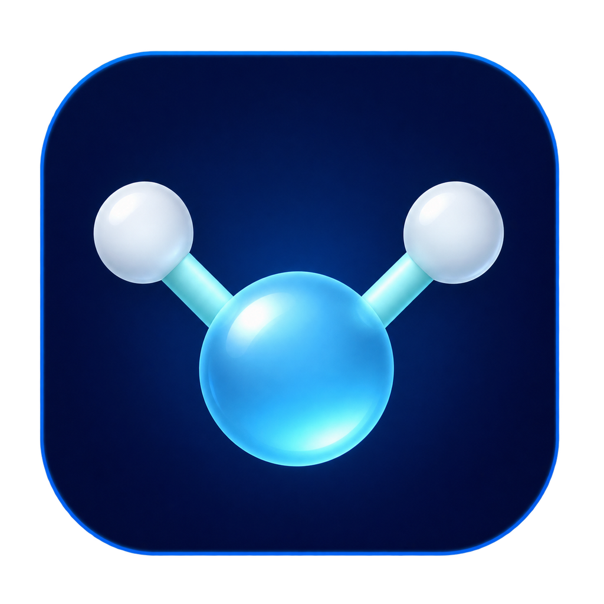

# Molecule Viewer



Настольный 3D-просмотрщик молекулярных структур и траекторий из Extended XYZ и HDF5. Приложение работает с локальными файлами и подгружает координаты по мере листания.

## Скачать

Готовые ZIP-архивы для macOS Apple Silicon и Windows x64 доступны в [релизе v1.3.1](https://github.com/NoRaw63/molecule-viewer/releases/tag/v1.3.1). На Windows распакуйте весь ZIP и запустите `MoleculeViewer.exe`. На macOS распакуйте ZIP и откройте `MoleculeViewer.app`.

## Использование

Откройте локальный файл через кнопку «Открыть файл…» или перетащите его в окно. Слева появятся формулы и число кадров, справа — выбранная структура. Для перехода к кадру можно ввести его номер, нажать «Назад» или «Вперёд» либо передвинуть ползунок. Перетаскивание мышью вращает структуру, прокрутка меняет масштаб.

Включите «Данные кадра», чтобы увидеть доступные поля, например энергию, силы и заряды. Щёлкните по полю, чтобы увидеть его значение или компоненты массива. Для больших массивов показывается начало и указано общее число компонентов.

- Поддерживаются Extended XYZ и HDF5 с доступными массивами координат и элементов. В HDF5 просмотрщик ищет такие массивы на разных уровнях, включая наборы отдельных геометрий, траектории с общей или покадровой таблицей элементов и плоские массивы со смещениями кадров. SPICE также поддерживается через SMILES с номерами атомов.
- Если автоматическое определение не срабатывает, откройте «Поля HDF5…» и укажите массив координат, массив символов или атомных номеров и единицы длины. Для повторяющихся групп допустим шаблон вроде `/molecules/*/coords`. Поля элементов и смещений можно задать абсолютным путём или относительно группы координат. Если единицы не заданы, используются ангстремы. Выбранные поля запоминаются для неизменившегося файла.
- Группировка использует формулу по Хиллу и порядок кадров. Изомеры с одинаковой формулой остаются в одной группе. В обычных массивах связи вычисляются по расстояниям, в SPICE берутся из SMILES.
- Первый проход по Extended XYZ строит индекс формул и позиций кадров на диске. Индекс занимает место в каталоге кэша приложения, определяемом операционной системой. Исходный файл открывается только для чтения. В памяти хранится текущая модель и до семи недавно просмотренных кадров в кэше объёмом до 32 МиБ по оценке размеров данных.

## Запуск из исходников

В среде Python 3.12 с установленными зависимостями:

```sh
python -m pip install -r requirements.txt
python viewer.py
```

Для быстрой проверки можно открыть [water-demo.extxyz](water-demo.extxyz) с двумя структурами воды и условными значениями энергии.

```sh
python viewer.py water-demo.extxyz
```


## Сборка

Для macOS Apple Silicon установите зависимости и PyInstaller 6.22.3, затем выполните:

```sh
python -m PyInstaller --noconfirm molecule_viewer.spec
```

Приложение появится в `dist/MoleculeViewer.app`. Для переносимого Windows x64 ZIP использованы Windows-версии библиотек из списка, Python 3.12.10 Embedded и лаунчер `windows_launcher.c`, собранный через Zig 0.15.2. Чтобы повторить упаковку, поместите Embedded Python в каталог `runtime` рядом с `MoleculeViewer.exe`. Скопируйте в `runtime` файлы `viewer.py`, `storage.py`, `hdf_layout.py`, `frame_data.py` и `MoleculeViewer.png`, а зависимости установите в `runtime/site-packages`. Скопируйте `msvcp140*.dll` из `runtime/site-packages/PySide6` в `runtime`. Укажите в `runtime/python312._pth` четыре строки: `python312.zip`, `.`, `site-packages` и `import site`.

Скомпилируйте `windows_icon.rc` с помощью `rc.exe` из Windows SDK, затем передайте ресурс в Zig.

```sh
rc.exe /fo viewer-icon.res windows_icon.rc
zig cc --target=x86_64-windows-gnu -municode -Wl,--subsystem,windows -O2 -s windows_launcher.c viewer-icon.res -luser32 -o MoleculeViewer.exe
```

## Иконка

Исходная иконка создана встроенным ImageGen. Промпт:

> A polished desktop application icon for Molecule Viewer, centered on a single scientifically recognizable H2O water molecule. Exactly one larger luminous ice-blue oxygen sphere centered slightly below the middle, exactly two smaller near-white hydrogen spheres above left and above right, two short thick pale-cyan bond sticks, bent V geometry about 104.5 degrees. Simple clean 3D ball-and-stick geometry, restrained studio highlights and subtle satin glass shading, crisp high contrast and unmistakable silhouette at 16 pixels. Behind the molecule a dark midnight navy rounded square tile, with a very subtle navy radial gradient and fine cool blue rim. The rounded-square tile should fill about 87% of the square canvas, with true transparent area outside the tile. Atom group fills about 70% of tile width. Straight-on composition, centered and symmetric. No lettering, no chemical labels, no extra atoms, no droplets, no surrounding symbols, no sparkles, no external drop shadow, no icon mockup. Single square raster application icon.
